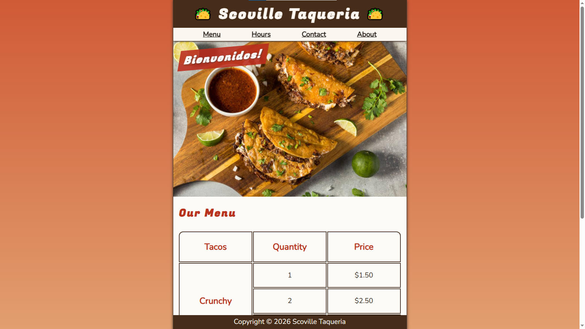

# Scoville Taqueria Website

## Description

Scoville Taqueria is a modern four-page restaurant website that presents the brand, full menu, store hours, contact form, and restaurant background story.

## Tech Stack

- HTML
- CSS
- JavaScript

## Features for Scoville Taqueria Website

- Main navigation area
- Store Hours
- Menu highlights
- Contact form
- About and taco trivia section

## Screenshots

The screenshots for all the web pages are in the `screenshots/` folder where the 4 pages can be quickly previewed. The filenames for the screenshots of the 4 pages are `home-screenshot.png`, `hours-screenshot.png`, `contact-screenshot.png`, and `about-screenshot.png`.

## Project Structure

- `index.html` for the homepage
- `hours.html` for store hours
- `contact.html` for the contact form and location details
- `about.html` for the restaurant story and trivia

## Notes

This project builds on the Scoville Taqueria HTML foundation with a primary focus on CSS styling and responsive layout. Minimal JavaScript is included only to automatically update the current year in the copyright section.
